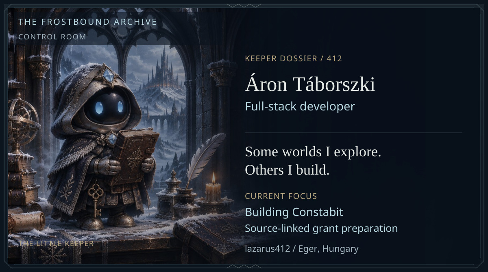
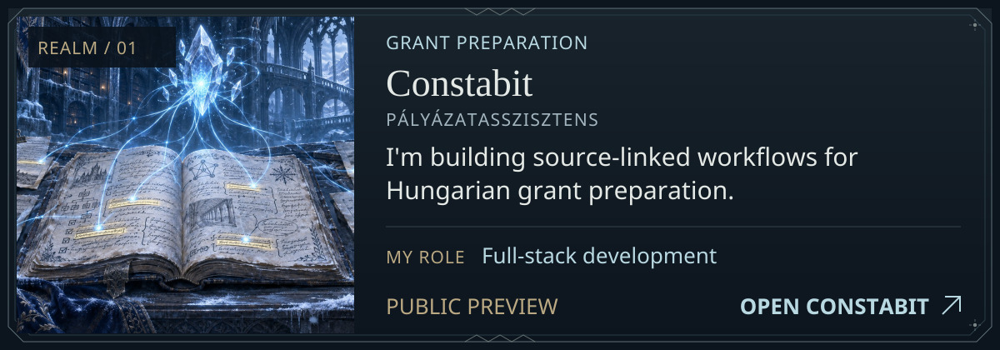
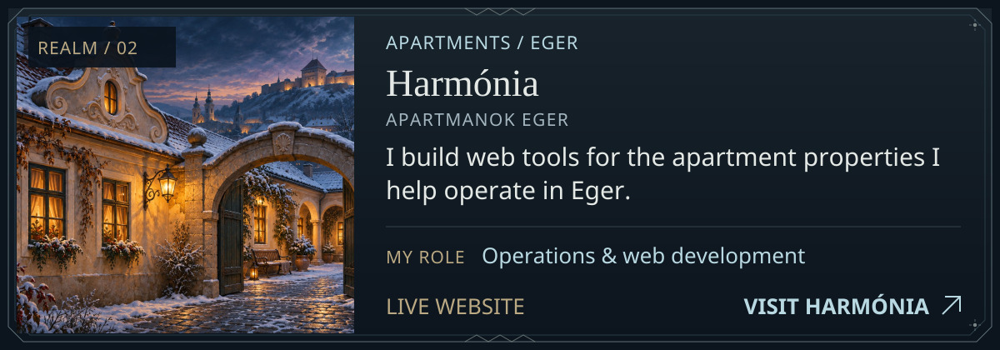
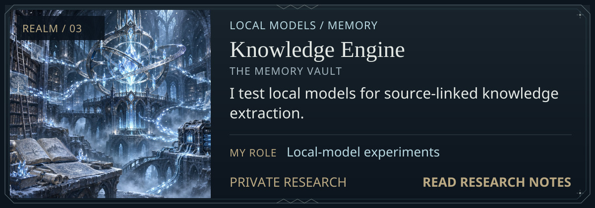
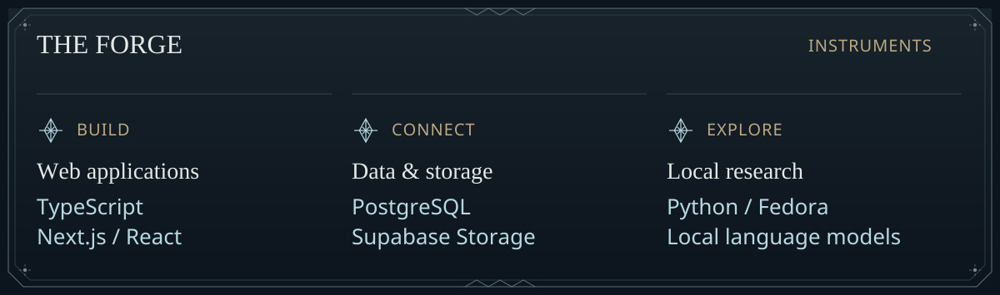
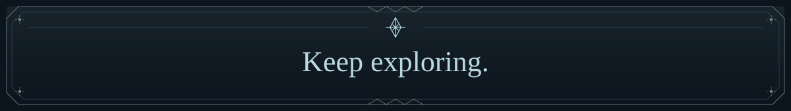

<!-- Generated from profile.json by scripts/build.py. -->

<picture>
  <source media="(max-width: 800px)" srcset="assets/control-room-mobile.jpg" />
  
</picture>

I build Constabit, help run apartment properties in Eger, and experiment with local language models.

[Project dossiers](#project-dossiers) · [Tech arsenal](#tech-arsenal) · [Archivist’s notes](#archivists-notes)

## Project dossiers / The Three Realms

<a href="https://palyazatasszisztens.hu/">
<picture>
  <source media="(max-width: 800px)" srcset="assets/realm-constabit-mobile.jpg" />
  
</picture>
</a>

<strong>Constabit</strong> · project record

I'm building Constabit to make Hungarian grant preparation easier to trace back to its sources. I want requirements, eligibility checks and budgets to stay connected to the documents behind them.

**My role:** Full-stack development.

**Available now:** Visitors can use an initial project-diagnosis flow and explore potential grant opportunities.

**In development:** Source-linked requirement extraction, eligibility-review workflows and structured budget planning.

[Open Constabit](https://palyazatasszisztens.hu/)

<a href="https://www.apartmanokeger.com/">
<picture>
  <source media="(max-width: 800px)" srcset="assets/realm-harmonia-mobile.jpg" />
  
</picture>
</a>

<strong>Harmónia</strong> · project record

I help run apartment properties in Eger and build the web tools around them. That means working with real guest questions, multilingual information and the practical details of day-to-day operations.

**My role:** Operations & web development.

**Available now:** The public website brings several locations together, presents apartment information in Hungarian, English and Polish, and supports date/party-size discovery and accommodation enquiries. Staff confirm availability and the final price.

[Open Harmónia](https://www.apartmanokeger.com/)

<a href="records/knowledge-engine.md">
<picture>
  <source media="(max-width: 800px)" srcset="assets/realm-knowledge-mobile.jpg" />
  
</picture>
</a>

<strong>Knowledge Engine</strong> · project record

I'm experimenting with small local language models to turn conversations into source-linked knowledge. The interesting part is measuring whether an extracted idea is actually supported by what was said.

**My role:** Local-model experiments.

**Research status:** Private experiments. I compare extracted ideas with the original conversation and look for unsupported or uncertain claims.

[Read research notes](records/knowledge-engine.md)

## Tech arsenal / The Forge

<picture>
  <source media="(max-width: 800px)" srcset="assets/tech-arsenal-mobile.jpg" />
  
</picture>

Read the instruments as text

**Web applications:** TypeScript, Next.js / React.

**Data & storage:** PostgreSQL, Supabase Storage.

**Local research:** Python / Fedora, Local language models.

About Áron · profile record

**Áron Táborszki · Full-stack developer · Eger, Hungary.**

I develop Constabit, build web tools around the apartment properties I help operate, and experiment with local AI. My current development focus is source-linked grant preparation.

## Archivist’s notes

> **Evidence before assertion.** When AI produces an answer, I want to know what supports it.

> **Keep exploring.** There is always another model to test, workflow to refine, or world to discover.

<picture>
  <source media="(max-width: 800px)" srcset="assets/archive-seal-mobile.jpg" />
  
</picture>

<a href="https://github.com/lazarus412">lazarus412</a> · The Frostbound Archive

